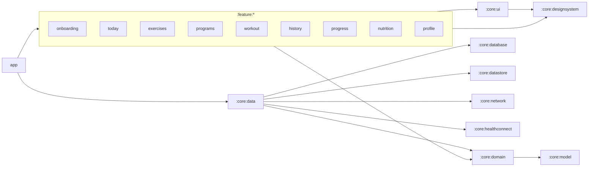
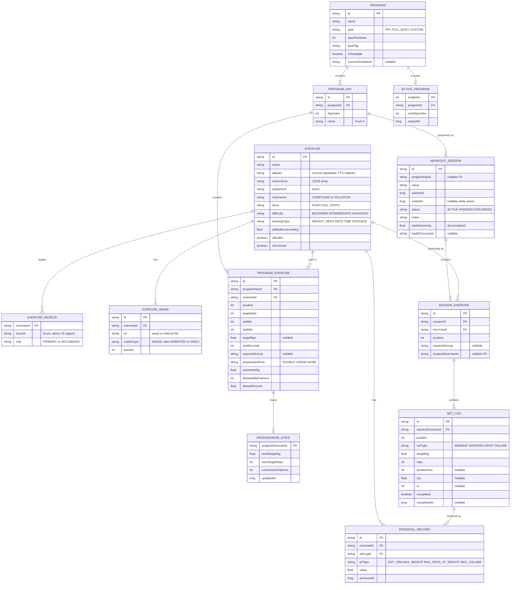
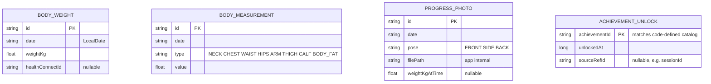
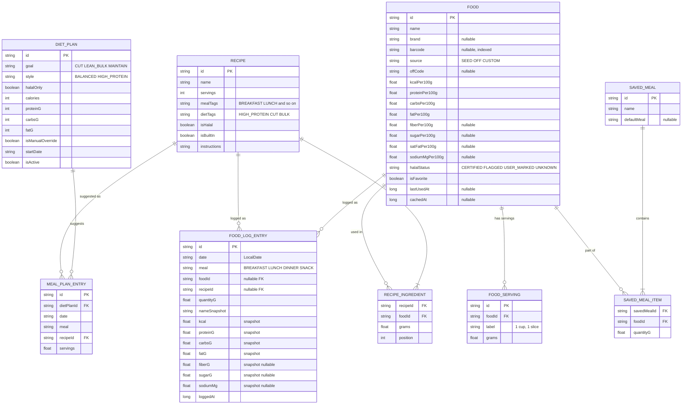

# Jalilgym — Product & Architecture Blueprint

> **Status:** v1.0 — **approved** (all §13 recommendations accepted). Phases 0–2 complete; Phase 3 (workout engine) next.
> **Created by CH.Djalil**

---

## 0. Decision Log (from the spec interview)

| # | Topic | Decision |
|---|---|---|
| 1.1 | App name | **Jalilgym** |
| 1.2 | Audience | Primary: intermediate lifters (3–5 days a week, progressive overload). Secondary: beginners, served through guided onboarding |
| 1.3 | Tone | Coach-like and supportive |
| 1.4 | Palette | Electric Lime `#C6FF00` / Steel Blue `#4F7CAC` / Near-black `#0E0F12` |
| 1.5 | Theme | Dark by default, light available |
| 1.6 | Typography | Bebas Neue (headings/numerals) + Inter (body) |
| 1.7 | UI style | Material Design 3 base with a bold athletic layer |
| 2.1 | Programs | Push/Pull/Legs, Full Body 3×/week, custom program builder |
| 2.2 | Progression | Auto-progression rules |
| 2.3 | Workout screen | Auto rest timer in the background, pre-filled logging, set types, RPE/RIR, plate calculator, 1RM calculator and tracking, warm-up generator, live lock-screen controls |
| 2.4 | Library | About 100 curated exercises, static images, interactive body heatmap, custom exercises, filters |
| 2.5 | Analytics | Weekly volume per muscle, strength charts, PR history, body weight and measurements |
| 3.1 | Diets | Bulking, cutting, maintenance/recomposition, high-protein, halal filtering and tagging |
| 3.2 | Plan generation | TDEE (Mifflin-St Jeor) → macros → meal suggestions from curated recipes |
| 3.3 | Tracking | Manual entry, Open Food Facts search, barcode scanner, saved meals, recipe builder, basic micronutrients |
| 3.4 / 3.5 | Hydration / grocery | **Out of scope** |
| 4.1 | Stack | Native Kotlin + Jetpack Compose (M3) |
| 4.2 | Architecture | Clean Architecture, MVVM/MVI, Hilt, Coroutines/Flow, Navigation Compose, multi-module |
| 4.3 | Storage | Room + typed DataStore (see §5.1 note) |
| 4.4 | Backend | Fully offline-first and local only. Repositories are designed so sync can be added later |
| 4.5 | Integrations | Health Connect |
| 4.6 | minSdk | 26 (Android 8.0) |
| 4.7 | Language | English only. All strings live in resources so the app can be translated later |
| 4.8 | Quality | Unit tests (ViewModels, calculators), Room DAO tests, Compose UI tests for critical flows, plus GitHub Actions CI (§13 Q9) |
| 5.1 | Onboarding | Goal + experience level |
| 5.2 | Retention | Streaks where rest days don't break them, achievements and badges, private progress photos |
| 5.3 | Monetization | 100% free, no ads |
| 5.4 | Accounts | None required |
| 6.1 | MVP scope | Both pillars (training and nutrition) at a basic level |
| 6.3 | Credit | "Created by CH.Djalil" shown in the app |

### 0.1 Assumptions (all confirmed — see §13)
- **A1. Active session timer is included.** You didn't select it, but session duration is needed for Health Connect workouts and for stats.
- **A2. Media in v1 is static images (WebP).** The data model leaves room for animated WebP or video later.
- **A3. Body stats** (sex, age, height, weight, activity level) are collected in a **Nutrition setup** step the first time you open Nutrition. Onboarding stays at two questions.
- **A4. Units** default to metric, with a metric/imperial toggle in Settings. Everything is stored internally in metric.
- **A5. Onboarding ends with a starter-program suggestion** based on goal and experience. You can skip it.

---

## 1. Product Vision

**Jalilgym is an offline-first training and nutrition coach for lifters who want structured progress without the noise.**
It tells you what to lift today, takes care of progression for you, gets out of the way during your sets, and pairs training with a calorie and macro plan that fits your goal, including halal-aware food choices.

**Principles**
1. **Fast in the gym.** You can log a set in two taps or fewer. Big numerals and big buttons work with sweaty hands.
2. **Coach, not cheerleader.** Clear guidance in a supportive tone, such as "Hit 12 reps on all sets, so weight goes up next time."
3. **Your data stays on your phone.** No account, no tracking, no ads. The only network calls are food lookups.
4. **Works with no signal.** Everything except Open Food Facts search works fully offline.

**Success metrics (local, measured with in-app counters only, nothing sent anywhere)**
- Average time to log a set under 3 seconds.
- A beginner can start a first workout within 2 minutes of install.
- Zero data loss across app updates (migration tests are mandatory).

---

## 2. Branding & Design System

### 2.1 Identity
- **Name:** Jalilgym (wordmark set in Bebas Neue, "JALILGYM", with lime accent on "GYM")
- **Tagline (proposal):** "Train with structure."
- **Credit "Created by CH.Djalil"** appears in:
  1. The welcome screen at the start of onboarding
  2. Settings → About (with version, licenses, and data attributions)
  3. The splash screen branding line (`windowSplashScreenBrandingImage`, Android 12+)

### 2.2 Color tokens (M3 roles)

| Role | Dark (default) | Light |
|---|---|---|
| `primary` | `#C6FF00` | `#4D6600` (darker lime for contrast on white) |
| `onPrimary` | `#0E0F12` | `#FFFFFF` |
| `primaryContainer` | `#3A4A00` | `#C6FF00` |
| `onPrimaryContainer` | `#E4FF8A` | `#141A00` |
| `secondary` | `#4F7CAC` | `#3A6390` |
| `onSecondary` | `#FFFFFF` | `#FFFFFF` |
| `secondaryContainer` | `#1F3550` | `#D3E4FF` |
| `background` | `#0E0F12` | `#F7F8F5` |
| `surface` | `#15171B` | `#FFFFFF` |
| `surfaceContainer` | `#1C1F24` | `#F0F2EC` |
| `surfaceContainerHigh` | `#24272D` | `#E8EBE3` |
| `onSurface` | `#E8EAED` | `#1A1C18` |
| `onSurfaceVariant` | `#A6ABB3` | `#45483F` |
| `outline` | `#3A3F47` | `#C5C8BC` |
| `error` | `#FF5A5F` | `#BA1A1A` |
| `success` (custom) | `#3DDC97` | `#1B7F55` |
| `warning` (custom) | `#FFB020` | `#8A5A00` |

- **Set-type colors:** warm-up = steel blue, working = lime, drop = amber, failure = red.
- **Heatmap scale:** 5 steps from `surfaceContainerHigh` up to `primary`.
- Every text/background pairing must meet **WCAG AA** (4.5:1 for body text, 3:1 for large numerals).
- Dynamic color (Material You) is **off**, so the brand palette stays consistent.

### 2.3 Typography
- **Display / headline:** Bebas Neue, used for screen titles, timers, and weight/rep numerals.
- **Title / body / label:** Inter, with **tabular figures** (`tnum`) on every number so columns don't jitter.
- Both fonts are under the SIL Open Font License and are **bundled** as font resources (not downloadable fonts), so they work offline.
- Respects system font scaling up to 200%. Numeric layouts must not clip.

### 2.4 Style rules ("M3 + bold athletic")
- Corner radius: 12dp on cards, 16dp on sheets, full pill shape on primary buttons.
- Primary action buttons are 56dp tall. In-workout touch targets are at least 56dp; elsewhere at least 48dp.
- Each screen has one hero numeral (today's calories, the timer, the current set).
- Motion: short (150–250ms) and purposeful, such as a PR celebration burst or a rest-timer ring. All motion respects the system "Remove animations" setting.
- Haptics: tick on set complete, strong pulse when rest ends.

---

## 3. Feature Specification

Priority: **P0** = v1.0 MVP, **P1** = v1.1, **P2** = later.

### 3.1 Onboarding — P0
1. Welcome screen (wordmark plus "Created by CH.Djalil")
2. Goal: Build muscle / Lose fat / Get stronger / General fitness / Endurance
3. Experience: Beginner / Intermediate / Advanced
4. Starter-program suggestion (A5), which you can skip:

| Experience | Suggested program |
|---|---|
| Beginner | Full Body 3×/week |
| Intermediate | PPL 3-day (or 6-day for "Build muscle") |
| Advanced | PPL 6-day, or "Build my own" |

5. Notification permission prompt, shown just before your first workout (not at install), with an explanation that it's for the rest timer.

**What goal and experience drive:** default rep ranges, progression increments, the starter program, the default nutrition goal (Lose fat → cut, Build muscle → lean bulk, others → maintenance), and how much explanatory copy beginners see.

### 3.2 Exercise Library — P0
- **About 100 curated exercises**, seeded from **free-exercise-db** (public domain, *Unlicense*). Two images per exercise (start and end positions), compressed to WebP and bundled in the APK (target ≤ 8 MB in total).
- **Fields:** name, aliases, instructions (step list), primary and secondary muscles, equipment, mechanics (compound/isolation), force (push/pull/static), difficulty, and `trackingType` (weight+reps, reps only, time, distance).
- **Interactive body heatmap (front and back):** original vector artwork drawn with Compose Canvas paths (about 16 muscle regions). Tapping a muscle filters the library. The same component also shows weekly volume in Progress.
- **Filters:** muscle, equipment, mechanics, difficulty, plus text search across names and aliases.
- **Custom exercises:** same fields, optional photo from the Photo Picker, editable and deletable. Deleting one that has history archives it instead of removing it.
- **Exercise detail screen:** images, instructions, muscles on the heatmap, and your personal history (PRs, estimated-1RM chart, last 5 sessions).

### 3.3 Programs — P0
**Built-in templates**

| Template | Days | Notes |
|---|---|---|
| PPL 3-day | Push / Pull / Legs | Rest days between sessions |
| PPL 6-day | Push / Pull / Legs ×2 | Day A is heavier, day B uses higher reps |
| Full Body 3×/week | A / B / A, then B / A / B | Alternates between two workouts |

**Custom program builder**
- Create a program, add days, and add exercises to each day.
- Per exercise you set: sets, rep range, target RPE (optional), rest time, superset group, and progression rule.
- Drag to reorder exercises. You can duplicate a day or a whole program.
- Built-in templates are read-only, but "Copy & customize" turns one into your own.

**Active program state:** which program is active, the next day in rotation, and the week number. Home always shows **"Today: Push A"** with a single "Start" button.

#### 3.3.1 Auto-progression engine (Decision 2.2 B)
The default rule is **double progression**. It runs per program exercise once a session is finished.

```
inputs: working sets of this exercise in the finished session, rule config
if every working set reps >= repMax (and RPE <= targetRpe + 1 when RPE logged):
    nextWeight = currentWeight + increment
    nextReps   = repMin
    failures   = 0
else if any working set reps < repMin:
    failures += 1
    if failures >= deloadAfterFailures (default 2):
        nextWeight = roundToPlate(currentWeight * (1 - deloadPercent))  // default 10%
        failures = 0
else:
    hold weight; aim for +1 rep next session
```

- **Default increments (metric):** lower-body compound +5 kg, upper-body compound +2.5 kg, isolation +1–2 kg (rounded to the equipment's step). Imperial equivalents: 10 / 5 / 2.5 lb.
- **Other rules you can pick:** *Linear* (+increment every successful session) and *None* (manual).
- The result is shown as a coach note in the summary screen, for example: "Bench Press: 80 → 82.5 kg next time 💪".
- The engine is a **pure Kotlin function** in `:core:domain` so it is fully unit-tested.

### 3.4 Active Workout — P0
**Screen layout:** a header with the session timer, then a list of exercise cards with set rows, then a sticky bottom bar with the rest timer and "Finish".

**Set row:** `type | previous (ghost text) | weight | reps | RPE/RIR | ✓`
- Weight and reps are **pre-filled** from the last session of the same exercise, or from the progression target when there is one.
- **Set types:** warm-up (W), working, drop (D), failure (F). Warm-up sets never count toward PRs, volume, or progression.
- **Supersets:** exercises in the same superset group appear linked. Rest starts only after the last exercise in the group.
- **RPE (6–10 in 0.5 steps) or RIR (0–5):** you choose which one in Settings. Either is optional.
- **✓ (complete):** starts the rest timer, gives haptic feedback, and runs the PR check right away (a PR badge appears inline).

**Rest timer**
- Default rest comes from the program exercise, with fallbacks: compound 180s, isolation 90s.
- Controls: +15s, −15s, skip.
- Runs while the app is in the background or the screen is locked. At the end you get a vibration plus sound (respecting silent mode) and a heads-up notification.

**Ongoing workout notification (foreground service)**
- Shows the exercise name, "Set 3 of 4", and a rest countdown using a chronometer countdown.
- Actions: **Complete set**, **+30s rest**, **Skip rest**, **Open**.
- On Android 16+, uses promoted/Live Update styling when available.
- Foreground service type: `specialUse` (workout session timer), with the justification Play requires. The service holds the session state; the UI connects to it.
- Survives process death: the in-progress session is saved to Room after every change and restored on restart.

**Tools (bottom sheets)**
- **Plate calculator:** target weight + bar weight (20/15/10 kg or 45/35 lb, editable) + your available plates (configurable inventory) → the plates to load on each side, plus the nearest weight you can actually load.
- **1RM calculator:** weight × reps → **Epley** `w × (1 + r/30)` and **Brzycki** `w × 36 / (37 − r)`. Valid for reps ≤ 12; beyond that it shows a "less accurate" warning. Also shows a percentage table (50–95%).
- **Warm-up generator:** for the first working weight W it suggests: bar × 10, 40% × 8, 60% × 5, 75% × 3, 85% × 1 (snapped to loadable plates). Sets that would come out below the bar weight are dropped. One tap inserts them as warm-up sets.

**Finishing a session:** a summary screen with duration, total volume, sets, PRs, progression notes, and any achievements unlocked. You can add notes. The session is written to Health Connect if enabled.

**Other details**
- Adding or swapping an exercise mid-session (swap suggests exercises for the same muscle).
- The screen stays awake while a workout is active (toggle in Settings).
- If you abandon a session, "Resume?" appears the next time you open the app.

### 3.5 Progress & Analytics — P0
- **Weekly volume per muscle:** working sets per muscle group shown on the heatmap and as a bar list. Primary muscle counts 1.0 set, secondary 0.5. Optional target bands (for example 10–20 sets).
- **Strength chart per exercise:** estimated 1RM (Epley, best set per session), top-set weight, or session volume. Ranges: 4W / 3M / 6M / 1Y / All.
- **PRs:** per exercise, tracks estimated 1RM, heaviest weight, most reps at a given weight, and best session volume. Full history timeline.
- **Body:** weight log with a 7-day moving-average trend line. Measurements: neck, chest, waist, hips, arms, thighs, calves, body-fat %.
- **Progress photos:** private and stored in app-internal storage, never in the public gallery. Taken with the camera or picked with the system Photo Picker (no storage permission needed). Tagged by pose (front/side/back). Side-by-side comparison with a slider and date labels. Excluded from Android cloud backup.

### 3.6 Gamification — P0
**Training streak ("rest days don't break streaks")**
- The streak counts **consecutive training weeks on target**, and the UI also shows "days since last workout".
- A week is on target when completed sessions ≥ the program's planned days per week (if no program is active, the target is 2).
- Mid-week the streak is still "alive" as long as the target is still reachable in the days left.
- One automatic **grace week** per 8 weeks absorbs a missed week (for illness or travel).

**Logging streak (nutrition):** consecutive days with at least one food entry. Under the hood this also uses a "1 miss per 7 days allowed" rule, so the overall model stays forgiving and consistent.

**Achievements (seed list of about 24, defined in code, unlocks stored in Room)**
- *Milestones:* First Workout, 10 / 50 / 100 / 250 Workouts
- *Streaks:* 4 / 12 / 26 / 52-week streak
- *Strength:* First PR, 10 PRs, Bodyweight Bench, 1.5× Bodyweight Squat, 2× Bodyweight Deadlift
- *Volume:* 10 t / 100 t / 1,000 t lifted in total
- *Nutrition:* First Meal Logged, 7-day Logging Streak, 30-day Logging Streak, Hit Macros 7 Days
- *Explorer:* Built a Custom Program, Created a Custom Exercise, First Progress Photo

Badges are shown as a grid in Profile. Locked badges show the requirement. An unlock shows a celebratory sheet on the summary screen.

### 3.7 Nutrition — P0 core, P1 extended
**Nutrition setup (first visit, A3):** sex, birth date, height, weight, activity level (5 levels: 1.2 to 1.9), goal, plan style, and halal preference.

**Targets (Decision 3.2 A):** BMR from **Mifflin-St Jeor**, multiplied by the activity factor to give TDEE.

| Goal | Calories | Protein | Fat | Carbs |
|---|---|---|---|---|
| Cut | TDEE − 20% (max −750 kcal) | 2.2 g/kg | 25% of kcal (≥ 0.6 g/kg) | Remainder |
| Lean bulk | TDEE + 10% (max +400 kcal) | 1.8 g/kg | 25% | Remainder |
| Maintenance / recomp | TDEE | 2.0 g/kg | 27% | Remainder |
| **High-protein style** (modifier on any goal) | — | **2.4 g/kg** | 25% | Remainder |

- **Safety floors:** at least 1,500 kcal for males and 1,200 kcal for females, and no more than 1% of body weight lost per week. If a target would cross a floor, the app clamps it and explains why.
- Every target can be overridden manually.
- A permanent disclaimer reads "Not medical advice."
- **Weekly check-in (P1):** compares the 7-day weight trend with the goal rate and suggests a ±100 kcal adjustment.

**Food logging (P0)**
- Meals: Breakfast / Lunch / Dinner / Snacks.
- Day view shows a calorie ring, macro bars, and basic micronutrients (fiber, sugar, saturated fat, sodium).
- **Manual entry:** quick-add calories and macros, or create a custom food.
- **Open Food Facts search** (needs network): results are cached in Room, so anything you've seen or logged before works offline. Requests send a custom User-Agent identifying Jalilgym. Attribution and the ODbL license are shown in About.
- **Barcode scanner:** CameraX plus ML Kit barcode scanning (on-device, bundled model). Looks the code up in the local cache first, then Open Food Facts. If it's not found, you can create the food with that barcode attached.
- **Saved meals / meal templates:** save a group of foods and log it in one tap. "Copy yesterday's breakfast" is also available.
- **Recents and favorites** appear at the top of search.

**Halal filtering and tagging (P0)**
- Each food gets a `halalStatus`:
  - `CERTIFIED`: the Open Food Facts labels include a halal certification
  - `FLAGGED`: ingredients or labels show pork, gelatin of unknown origin, or alcohol
  - `USER_MARKED`: you marked it yourself
  - `UNKNOWN`: the default
- Filter options are "Show all", "Hide flagged", or "Certified/user-marked only".
- Curated recipes are written halal-compliant and tagged.
- The UI uses careful wording ("Labeled halal", "Contains flagged ingredient") and never claims something is halal without a label.

**Recipe builder (P1):** ingredients and grams, plus number of servings, give per-serving macros. A recipe can be logged like any food.

**Meal suggestions (P1, Decision 3.2 A):** about 60 curated recipes (halal, tagged by meal type and by high-protein/cut/bulk). A greedy fill algorithm suggests a day of meals that lands within ±5% of calories and ±10 g of protein. You can swap any meal.

---

## 4. Screen Map & Navigation

**Bottom navigation (5 tabs):** Today · Train · Nutrition · Progress · Profile.
The active workout is a full-screen destination. When you minimize it, it collapses to a persistent mini-bar above the bottom navigation.

```mermaid
flowchart TD
    Launch([App launch]) --> Splash[Splash]
    Splash -->|first run| OB1[Welcome - Created by CH.Djalil]
    OB1 --> OB2[Goal]
    OB2 --> OB3[Experience]
    OB3 --> OB4[Starter program suggestion]
    OB4 --> Today
    Splash -->|returning| Today

    subgraph Tabs[Bottom navigation]
        Today[Today dashboard]
        Train[Train]
        Nutrition[Nutrition - Day view]
        Progress[Progress]
        Profile[Profile]
    end

    Today --> AW[Active workout]
    Today --> FoodSearch
    Train --> ProgList[My programs]
    Train --> Templates[Template gallery]
    Train --> Library[Exercise library]
    Train --> History[Workout history]
    ProgList --> ProgEdit[Program builder]
    ProgEdit --> DayEdit[Day editor]
    DayEdit --> ExPicker[Exercise picker]
    Templates --> ProgEdit
    Library --> ExDetail[Exercise detail]
    Library --> ExCustom[Create custom exercise]
    History --> SessionDetail[Session detail]
    ProgList --> AW
    AW --> Plate[Plate calculator sheet]
    AW --> OneRM[1RM calculator sheet]
    AW --> Warm[Warm-up generator sheet]
    AW --> ExPicker
    AW --> Summary[Workout summary]

    Nutrition --> NSetup[Nutrition setup]
    Nutrition --> FoodSearch[Food search]
    FoodSearch --> Barcode[Barcode scanner]
    FoodSearch --> FoodDetail[Food detail and serving]
    FoodSearch --> CustomFood[Create custom food]
    Nutrition --> SavedMeals[Saved meals]
    Nutrition --> Targets[Targets and plan]
    Nutrition -.P1.-> Recipes[Recipe builder]
    Nutrition -.P1.-> MealPlan[Meal suggestions]

    Progress --> Volume[Muscle volume heatmap]
    Progress --> StrengthChart[Strength charts]
    Progress --> PRs[Personal records]
    Progress --> Body[Body weight and measurements]
    Progress --> Photos[Progress photos]
    Photos --> Compare[Side-by-side compare]

    Profile --> Badges[Achievements]
    Profile --> Settings[Settings]
    Settings --> HC[Health Connect]
    Settings --> Units[Units and preferences]
    Settings --> Backup[Export and import]
    Settings --> About[About - Created by CH.Djalil]
```



**Today dashboard:** today's planned workout with a Start button · streak chip · calories and macros remaining · latest PR · steps (from Health Connect, if enabled).

**Navigation implementation:** Navigation Compose with **type-safe routes** (kotlinx.serialization `@Serializable` route objects). Each feature module exposes a `NavGraphBuilder.featureGraph()` extension, and `:app` puts them together. Deep links: `jalilgym://workout/active` (used by the notification) and `jalilgym://nutrition/scan`.

---

## 5. Technical Architecture

### 5.1 Stack
| Concern | Choice |
|---|---|
| Language | Kotlin 2.x (K2 compiler), JVM target 17 |
| UI | Jetpack Compose (BOM), Material 3, Material Icons Extended |
| Architecture | Clean Architecture + **MVI-flavoured MVVM**: `UiState` (immutable) + `UiEvent` → ViewModel → `StateFlow` |
| DI | Hilt (KSP) |
| Async | Coroutines + Flow |
| Navigation | Navigation Compose, type-safe routes |
| Database | Room (KSP), exported schemas, auto- and manual migrations |
| Preferences | **Typed DataStore** with a kotlinx.serialization JSON serializer* |
| Network | Retrofit + OkHttp + kotlinx.serialization (Open Food Facts only) |
| Images | Coil 3 |
| Charts | Vico (Compose-native charts) |
| Camera / barcode | CameraX + ML Kit Barcode Scanning (bundled model) |
| Health | Health Connect client (`androidx.health.connect:connect-client`) |
| Background | WorkManager (Health Connect sync, cleanup), Foreground Service (workout) |
| Splash | AndroidX Core SplashScreen |
| Build | Gradle Kotlin DSL, **version catalog** (`libs.versions.toml`), **convention plugins** in `build-logic/` |
| Static analysis | Android Lint, ktlint (via Spotless), Detekt |
| SDK levels | `minSdk 26`, `compileSdk 37`, `targetSdk 37` (Android 17) |
| Package | `com.chdjalil.jalilgym` |
| Toolchain (at Phase 0) | Gradle 9.8.2 · AGP 9.4.0 (built-in Kotlin) · Kotlin 2.4.21 · KSP 2.3.12 · Hilt 2.60.1 · Compose BOM 2026.09.00 · Room 2.8.5 · JDK 17 |

\* *Change from the interview's "Proto DataStore":* settings use the same typed `DataStore<T>` API, but serialize with kotlinx.serialization (already used for navigation and seed data) instead of protobuf. That avoids the protoc Gradle plugin and keeps every field defaulted, so adding a setting never needs a migration. The guarantees are the same: atomic, transactional, Flow-based, and corruption-handled.

### 5.2 Layering
```
UI (Compose screens)  ──events──▶  ViewModel  ──calls──▶  UseCase (domain)
        ▲                              │                      │
        └────── StateFlow<UiState> ────┘                      ▼
                                                     Repository (interface in domain)
                                                              │ impl in :core:data
                                       ┌──────────────────────┼─────────────────────┐
                                       ▼                      ▼                     ▼
                                Room DAOs           Proto DataStore        OFF API / Health Connect
```
- **Domain is pure Kotlin.** It has no Android imports and holds the use cases plus the calculators: progression, 1RM, plates, warm-up, TDEE, streaks, PR detection, and volume.
- **Repositories are offline-first.** Room is the single source of truth. The network only fills the cache.
- **Ready for sync later:** every syncable row has a UUID string primary key, `createdAt`, `updatedAt`, and a `deletedAt` soft-delete column. The domain never depends on auto-increment IDs.
- **Units are canonical:** values are stored as kg, cm, g, kcal, and epoch milliseconds (UTC). Diary dates are stored as `LocalDate` strings in the user's timezone. Conversion happens only in the UI formatting layer.

### 5.3 Module structure
```
:app                          – Application, MainActivity, NavHost, Hilt entry
:build-logic:convention       – Gradle convention plugins

:core:model                   – Pure Kotlin domain models & enums
:core:domain                  – Use cases + calculators (pure Kotlin, heavily unit-tested)
:core:data                    – Repository implementations
:core:database                – Room DB, entities, DAOs, migrations, seed loader
:core:datastore               – Typed DataStore (user prefs, onboarding, body profile, seed version)
:core:network                 – Open Food Facts client
:core:healthconnect           – Health Connect wrapper
:core:designsystem            – Theme, colors, type, JG* components, body heatmap
:core:ui                      – Shared composables (charts wrappers, pickers, number steppers)
:core:common                  – Dispatchers, Result, time & unit formatting
:core:testing                 – Fakes, test rules, fixtures

:feature:onboarding
:feature:today
:feature:exercises            – Library, detail, custom exercise
:feature:programs             – Templates, builder
:feature:workout              – Active session, tools sheets, summary, WorkoutService
:feature:history
:feature:progress             – Charts, PRs, volume, body, photos
:feature:nutrition            – Day view, setup, targets, search, scanner, saved meals, recipes
:feature:profile              – Achievements, settings, about, backup
```


Rule: feature modules never depend on other feature modules. They talk to each other only through navigation routes and the domain layer.

### 5.4 Seed data
- `:core:database` ships with `assets/seed/` JSON: exercises, muscle mappings, program templates, curated recipes (P1), and the generic-foods seed (see §13 Q5).
- On the first database creation, a `SeedLoader` in the `RoomDatabase.Callback` imports the seed in a single transaction. Each seed file has a version number, so later app updates can add exercises without touching user data. Seed rows have `isBuiltIn = true`.
- Seed data is checked by a unit test: every exercise has at least one primary muscle, valid enum values, and an image file that exists.

### 5.5 Health Connect (P1)
| Record | Direction | When |
|---|---|---|
| `ExerciseSessionRecord` (strength training) | Write | When a workout finishes |
| `WeightRecord` | Read + write | When body weight is logged; imported periodically |
| `NutritionRecord` | Write | For each food log entry (aggregated per meal) |
| `StepsRecord` | Read | Shown on the Today dashboard |

- Optional, and turned on in Settings. Permissions are requested per data type. Writes are idempotent using `clientRecordId` = our row UUID.
- If you're not using Health Connect, nothing appears or is requested. On Android 9–13 the Health Connect app has to be installed; Android 14+ has it built in.

### 5.6 Permissions
| Permission | Why | When requested |
|---|---|---|
| `POST_NOTIFICATIONS` | Rest timer and ongoing workout notification | Before the first workout |
| `FOREGROUND_SERVICE`, `FOREGROUND_SERVICE_SPECIAL_USE` | Workout session service | Manifest only |
| `VIBRATE`, `WAKE_LOCK` | Rest alert, keeping the screen on | Manifest only |
| `CAMERA` | Barcode scanner, progress photos | At first use |
| `INTERNET`, `ACCESS_NETWORK_STATE` | Open Food Facts | Manifest only |
| Health Connect read/write permissions | §5.5 | When you turn it on in Settings |

There is no storage permission (the Photo Picker and app-internal storage don't need one), no location, and no analytics SDKs.

### 5.7 Backup & data portability
- **Android Auto Backup:** includes the Room database and DataStore, and excludes the photos folder and the food cache.
- **Manual JSON export/import (P1):** writes the full data set (minus photos) to a file you pick through the Storage Access Framework, so it can go to Drive, Downloads, or anywhere else. A ZIP option that includes photos comes later (P2).

---

## 6. Data Model

Conventions: `id` is a UUID string. Every user-editable table also has `createdAt`, `updatedAt`, and `deletedAt?` (left out of the diagrams to keep them short). Weights are kg, lengths cm, energy kcal, mass g.

### 6.1 Training


### 6.2 Body, progress & gamification

The training and logging streaks are **computed** from `WORKOUT_SESSION` and `FOOD_LOG_ENTRY`. A cached snapshot is kept in DataStore so the Today screen loads instantly.

### 6.3 Nutrition

Log entries store a **macro snapshot**, so editing or re-caching a food never changes past diary days.

### 6.4 DataStore (`UserPreferencesData`)
Shown in protobuf-style notation for readability; the implementation is a `@Serializable` Kotlin data class in `:core:datastore`. Fields are added phase by phase.
```proto
message UserPreferences {
  bool onboarding_complete = 1;
  Goal goal = 2;                       // BUILD_MUSCLE, LOSE_FAT, STRENGTH, GENERAL, ENDURANCE
  ExperienceLevel experience = 3;
  UnitSystem units = 4;                // METRIC default
  ThemeMode theme = 5;                 // DARK default, LIGHT, SYSTEM
  EffortScale effort_scale = 6;        // RPE, RIR, OFF
  int32 default_rest_compound_sec = 7; // 180
  int32 default_rest_isolation_sec = 8;// 90
  bool keep_screen_on = 9;
  float bar_weight_kg = 10;
  repeated float available_plates_kg = 11;
  BodyProfile body_profile = 12;       // sex, birth_date, height_cm, activity_level
  bool health_connect_enabled = 13;
  HalalFilter halal_filter = 14;       // ALL, HIDE_FLAGGED, CERTIFIED_ONLY
  StreakSnapshot streak_cache = 15;
}
```

---

## 7. Key Algorithms (all pure functions in `:core:domain`, each unit-tested)
| Function | Notes |
|---|---|
| `estimate1Rm(weight, reps, formula)` | Epley/Brzycki. Returns null for reps = 0. Flagged as inaccurate for reps > 12 |
| `calculatePlates(target, bar, inventory)` | Greedy per side, using the plate pairs available. Returns the plate list plus the closest loadable weight |
| `generateWarmups(workingWeight, bar, inventory)` | The percentage scheme from §3.4, snapped to plates, with duplicates removed |
| `applyProgression(rule, state, sets)` | §3.3.1 |
| `detectPrs(set, history)` | Ignores warm-up sets |
| `weeklyMuscleVolume(sessions, mappings)` | Primary muscle 1.0, secondary 0.5 |
| `computeTdee(profile, weight)` / `computeTargets(goal, style, tdee, weight)` | §3.7, including the safety clamps |
| `computeTrainingStreak(sessions, plannedPerWeek, today)` | §3.6 |
| `suggestMealPlan(targets, recipes, halalOnly)` (P1) | Greedy fill with a tolerance |
| `UnitFormatter` | kg↔lb (1 kg = 2.20462 lb), cm↔in. Rounds weights to the plate step |

---

## 8. Non-Functional Requirements
- **Performance:** cold start under 1.5 s on a mid-range device (Baseline Profiles). Smooth scrolling in the library and history (stable keys, `@Immutable` UI models). Logging a set must not cause a recomposition of the whole list.
- **Reliability:** each set is written to Room the moment it's checked. The active session survives process death and reboot (it resumes on next launch).
- **Data integrity:** Room schemas are exported to `core/database/schemas/`. **Every schema change comes with a migration test.** Destructive migration is never allowed.
- **Accessibility:** TalkBack labels on every control, including the heatmap regions and the timer. Contrast AA. 48/56dp touch targets. Works up to 200% font scale.
- **Privacy:** no analytics, no crash reporting SDK, no ads. Open Food Facts calls send only the barcode or search text. Photos stay in app-internal storage.
- **Offline:** every feature works offline except Open Food Facts lookup, which shows a clear "Offline: showing cached and custom foods" state.
- **APK size:** target under 30 MB (images as WebP, R8 full mode, resource shrinking).
- **Localization readiness:** no hard-coded strings, plurals in resources, and layouts that won't break in RTL (only English ships in v1).

---

## 9. Testing Strategy (Decision 4.8)
| Layer | Tools | Scope |
|---|---|---|
| Domain unit tests | JUnit 5, Truth/Kotest assertions | Every calculator in §7, using table-driven cases. Target coverage ≥ 90% for `:core:domain` |
| ViewModel tests | JUnit, Turbine, kotlinx-coroutines-test, fake repositories from `:core:testing` | State transitions for onboarding, active workout, program builder, food logging |
| Room DAO tests | AndroidX Test + in-memory Room (instrumented or Robolectric) | All DAO queries and Flows, cascade and soft-delete behavior, **migration tests** |
| Compose UI tests | `compose-ui-test` + Hilt testing | Critical flows: (1) onboarding → first workout start, (2) log sets → rest timer → finish → summary shows PR, (3) build a custom program, (4) search or scan → log food → totals update |
| Network | MockWebServer | Open Food Facts parsing, halal label mapping, offline fallback |

**CI (§13 Q9):** `.github/workflows/ci.yml` runs assemble, unit tests (including Robolectric DAO and Compose tests), Android lint, and a check that the Room schema is committed, on every push and PR. Compose UI tests run on Robolectric, so CI needs no emulator.

---

## 10. Phased Roadmap

### v1.0 MVP (training complete, nutrition core)
| Phase | Scope | Exit criteria |
|---|---|---|
| **0. Foundation** ✅ | Gradle multi-module setup with build-logic and version catalog, Hilt, design system (theme, fonts, core components), navigation shell with 5 tabs, typed DataStore, Room v1 schema plus seed loader, splash screen with credit | App builds, launches to an empty shell, theme toggles dark/light, seed import is tested |
| **1. Onboarding & Library** ✅ | Onboarding (welcome, goal, experience, suggestion), exercise library (about 100 exercises with images), filters, search, detail, body heatmap component, custom exercises | A new user finishes onboarding and browses or filters the library |
| **2. Programs** ✅ | PPL 3/6-day and Full Body templates, custom builder (days, exercises, supersets, rules), active program and rotation, Today card | You can start "Today: Push A" from Home |
| **3. Workout engine** | Active workout UI, pre-fill, set types, RPE/RIR, supersets, rest timer, foreground service with notification actions, plate / 1RM / warm-up sheets, progression engine, summary, history, crash-safe session restore | Critical UI flow 2 passes; the rest timer fires with the screen locked |
| **4. Progress & gamification** | PR detection and history, strength charts, weekly muscle volume heatmap, body weight and measurements, progress photos and compare, streaks, achievements | Badges unlock correctly in tests; charts render real data |
| **5. Nutrition core** | Nutrition setup, TDEE and target calculation (goal plus high-protein style), day diary, manual entry, Open Food Facts search with caching, barcode scanner, custom foods, saved meals, basic micronutrients, halal status and filter, logging streak | Critical UI flow 4 passes; offline mode works |
| **6. Hardening & release prep** | Accessibility pass, Baseline Profiles, R8, migration test baseline, About/licenses (Open Food Facts ODbL, free-exercise-db, fonts), Play listing assets, `specialUse` FGS declaration | Release build signed; all tests green |

**Phase 0 notes.** It shipped with a starter seed of 18 exercises, enough to cover the PPL and Full Body templates; Phase 1 expands this to about 100 with images. The Room schema is committed under `core/database/schemas`, and the `Update Room schema` workflow regenerates it whenever the database module changes. Compose UI tests run on Robolectric. Remaining Phase 0 follow-ups: ktlint/Detekt and Baseline Profiles (moved to Phase 6).

**Phase 1 notes.** 99 curated exercises from free-exercise-db with bundled WebP photos (≈3 MB). The body heatmap is original artwork generated from `tools/heatmap/body.py`. Custom exercises are soft-deleted so history stays intact.

**Phase 2 notes.** Templates are seeded from `assets/seed/programs.json`. Exercises and days are reordered with up/down actions (accessible); drag-and-drop may come later. The onboarding starter choice is turned into an active program on first launch after onboarding. "Start workout" is visible but disabled until Phase 3.

### v1.1
Recipe builder · curated recipes and meal suggestions · Health Connect (workouts, weight, nutrition, steps) · JSON export/import · weekly nutrition check-in (calorie auto-adjust).

### v2 candidates (out of scope now)
Hydration tracker · grocery list · workout reminders and weekly summary notifications · Glance home widgets · animated or video exercise media · more program types (Upper/Lower, powerlifting, HIIT, calisthenics, home) · cloud sync (Supabase or Firebase) with optional account · Wear OS · more languages (FR/AR with RTL).

---

## 11. Explicitly Out of Scope for v1
Hydration, grocery list, social features or leaderboards, accounts and cloud sync, monetization or billing or ads, AI-generated plans, keto / intermittent fasting / vegan plan types, reminder notifications, widgets, Wear OS, video media, and languages other than English.

---

## 12. Risks & Mitigations
| Risk | Mitigation |
|---|---|
| Play policy rejects the `specialUse` foreground service | Write a clear justification. Fallback: the `health` FGS type with `ACTIVITY_RECOGNITION`, or a timer based on an exact alarm |
| Open Food Facts data is incomplete or wrong | Users can edit a cached food into their own custom copy. Halal status is never inferred as "certified" without a label |
| Halal classification causes trust problems | Conservative wording, a visible "how this is determined" info sheet, and user override |
| Exercise image licensing | Use only free-exercise-db (Unlicense) and original artwork. Attribution goes in About |
| Body heatmap artwork effort | Simplified original vector regions. Polish can be iterated later without schema changes |
| Scope creep in nutrition | Recipes and meal suggestions are deliberately in v1.1 |

---

## 13. Resolved Questions
All recommendations were accepted (*"all recommended"*):

| # | Question | Decision |
|---|---|---|
| Q1 | Active session timer | **Included** |
| Q2 | Exercise media | **Static WebP images in v1**; model supports animated/video later |
| Q3 | Body stats | Collected in **Nutrition setup**, not onboarding |
| Q4 | Units | **Metric default**, toggle in Settings |
| Q5 | Offline generic foods | **Bundle ~300 USDA FoodData Central foods** (public domain) |
| Q6 | Starter program | **Suggested at the end of onboarding** (skippable) |
| Q7 | Package name | **`com.chdjalil.jalilgym`** |
| Q8 | PPL variants | **Both 3-day and 6-day** |
| Q9 | CI | **GitHub Actions** added in Phase 0 |
| Q10 | Release split | **As in §10**: Health Connect, recipe builder and meal suggestions in v1.1 |

---

*Jalilgym — Created by CH.Djalil*
